# IEMS 469 — Assignment 1 Report

**Name:** Jianing Chen  
**GitHub username:** jianingchenNU  
**Repository:** mlds_assignment1_Jianing  
**Link:** <https://github.com/jianingchenNU/mlds_assignment1_Jianing>

---

## 1. How to run

**Hardware used for the reported results:** Windows 11, Python 3.13, PyTorch with CUDA; CartPole
was trained on the CPU and Pong on an NVIDIA RTX 5070 Ti GPU. Dependencies are listed in
`requirements.txt`. Run every command from the repository root; all randomness is seeded
(`--seed`, default 0).

**Run** (unit tests take seconds, Part A seconds, CartPole ~30 s, Pong ~3–4 h on a GPU):

```
python -m pytest                                   # unit tests
python -m mdp.run_all && python -m mdp.plot_mdp     # Part A: solve, Figures 1-3
python -m pg.train --env <cartpole|pong> --baseline <none|value>    # Part 1: none, Part 2: value
python -m pg.evaluate --run <env>_<baseline>_s0    # 500-episode evaluation, prints mean and std
python -m pg.plot_pg --env <cartpole|pong>         # training curves, histograms, comparisons
```

Defaults follow the assignment (Adam, γ = 0.95 CartPole / 0.99 Pong, lr 0.01), except the Pong
learning rate, which is 0.001 (3.1.1). A Pong run that stops continues with `--resume`. Each
validation experiment is one command, given in the section that uses it; results go to
`results/validation/` and `figures/validation/`. The README lists every command.

---

## 2. Value and Policy Iteration (shuttle dispatch)

### 2.1 MDP formulation

| Element | Definition |
|---|---|
| State | `s ∈ {0, 1, …, 200}` = customers waiting at the start of a period (201 states) |
| Action | `a ∈ {0, 1}`: 0 = wait, 1 = dispatch one shuttle |
| Order of events | observe `s` → choose `a` → shuttle takes `min(s, K)` → holding cost on those left → `A_t` new customers arrive |
| One-period cost | `c(s, a) = c_f · a + c_h · max(s − K a, 0)` |
| Transition | `s' = min(max(s − K a, 0) + A, 200)`, `A ~ Unif{1,…,5}` |
| Objective | minimize `E[Σ_t γ^t c(s_t, a_t)]`, `γ = 0.95` |

Parameters: `K = 15, c_f = 100, c_h = 2, S_MAX = 200, γ = 0.95`.

When several arrival values are truncated to 200, their probabilities are added (e.g. from
`s = 198, a = 0`: `P(s' = 199) = 0.2`, `P(s' = 200) = 0.8`). The model is stored as a cost matrix
of shape (201, 2) and a transition tensor `P` of shape (2, 201, 201); every row of `P` is checked to
sum to 1 when the model is built. Bellman equation (costs, so min):

`V(s) = min_a { c(s, a) + γ Σ_{s'} P(s' | s, a) V(s') }`

**Assumptions.**

1. The holding cost is charged on the customers left after dispatch; customers arriving during period
   `t` are first charged in period `t + 1`.
2. Customers who arrive when the station already holds 200 people leave at no cost (truncation).
3. Dispatching at `s = 0` is a legal action that costs `c_f`.
4. Ties are broken toward "wait" (enumeration, value iteration); policy iteration keeps the current
   action unless the other one is better by more than 10⁻¹⁰.

### 2.2 Methods

**(a) Enumeration (backward induction), T = 500.** `V_T ≡ 0`; for `t = T−1, …, 0`:
`Q_t(s, a) = c(s, a) + γ P_a V_{t+1}`, `V_t = min_a Q_t`, `π_t = argmin_a Q_t`. This gives `V_0`
and the time-indexed policy `π_t` (500 × 201).

**(b) Value iteration, T = ∞.** Start from `V_0 ≡ 0` and apply the Bellman operator until
`‖V_{k+1} − V_k‖_∞ < 10⁻⁸`. Converged in **429 iterations**.

**(c) Policy iteration.** Start from "never dispatch". Evaluation solves `(I − γ P_π) V = c_π`
exactly; improvement takes the greedy action (ties keep the current action). Converged in
**6 iterations**; number of states whose action changed per iteration: `[196, 28, 22, 7, 1, 0]`.

### 2.3 Results

| Method | s* (dispatch iff s ≥ s*) | Iterations | V(0) | V(200) |
|---|---|---|---|---|
| Enumeration, `V_0` (T = 500) | 13 | 500 backward steps | 576.67 | 3821.59 |
| Value iteration | 13 | 429 | 576.67 | 3821.59 |
| Policy iteration | 13 | 6 | 576.67 | 3821.59 |

`‖V_VI − V_PI‖_∞ = 1.9·10⁻⁷`, `‖V_enum,0 − V_PI‖_∞ = 4.9·10⁻⁹`, and the VI and PI policies are
identical in all 201 states.

<figure>
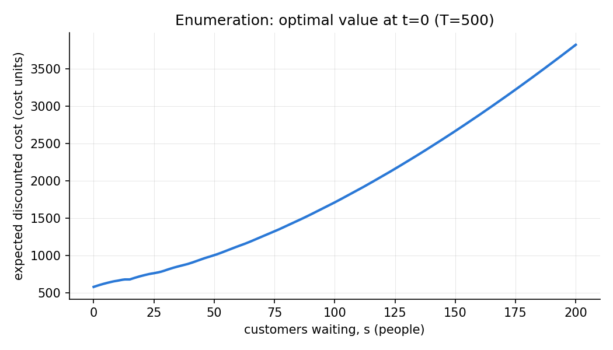
<figcaption>Figure 1. (a) Enumeration, T = 500: optimal expected discounted cost at t = 0 vs. number of customers waiting.</figcaption>
</figure>

<figure>
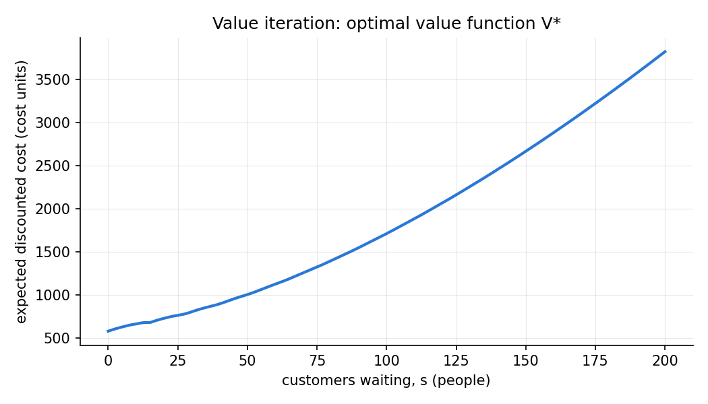
<figcaption>Figure 2. (b) Value iteration: optimal value function V* vs. number of customers waiting.</figcaption>
</figure>

<figure>
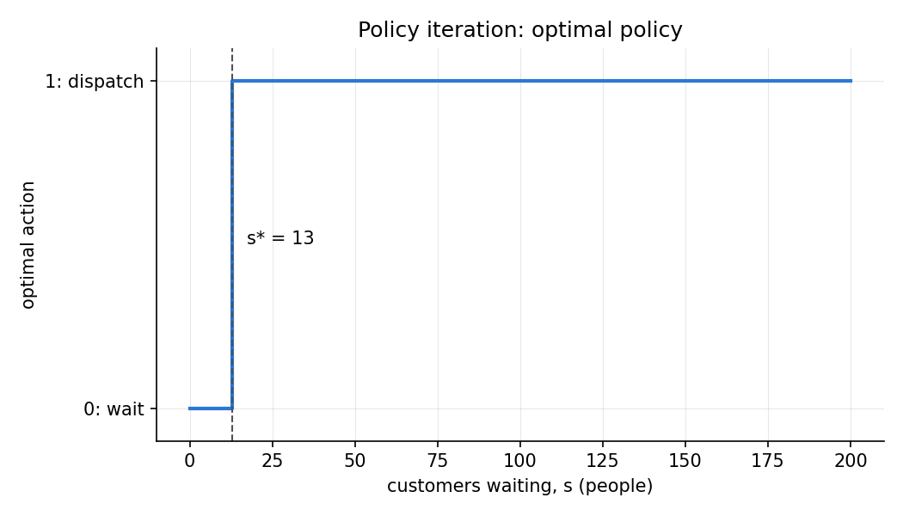
<figcaption>Figure 3. (c) Policy iteration: optimal action vs. number of customers waiting; threshold s* = 13.</figcaption>
</figure>

**Interpretation.** The optimal policy is a threshold rule: wait while fewer than 13 people are at the
station and dispatch once 13 or more are waiting. The threshold is below the capacity 15 because
waiting one more period with 13 people costs 26 now and pushes the system toward states where some
customers cannot board. `V` is increasing and convex-looking in `s`: each extra waiting customer costs
more when the queue is already long, since above `K` the leftover people have to wait for several
trips. The small kink near `s ≈ 13–15` is where the policy switches from waiting to dispatching.

### 2.4 Edge cases and how they are handled

| Edge case | Handling | Evidence |
|---|---|---|
| Dispatch with an empty station (`s = 0`) | Allowed, cost exactly `c_f = 100`, next state `A` | unit test; never chosen by the optimal policy |
| Dispatch with fewer than K people | `max(s − K, 0) = 0`, everyone boards, no negative states | unit tests on cost and transition |
| More than K people when dispatching | `s − K` remain and pay holding cost; one shuttle per period | unit test (`c(20, 1) = 100 + 2·5 = 110`; dispatch from 200 → 186…190) |
| Station cap at 200 | arrival values that overflow are mapped to 200 and their probabilities **added** | unit test; every row of `P` sums to 1 (checked on construction) |
| Cap makes holding cost bounded | Never dispatching costs at most `2·200 = 400` per period, `V_never(200) = 400/(1−γ) = 8000` exactly | with `c_f = 800` the optimal policy never dispatches; checked against all 200 threshold policies, none is better in any state |
| Ties between actions | VI/enumeration → wait; PI keeps the current action within 10⁻¹⁰ so it cannot cycle | `c_f = 0`: at `s = 0` both actions cost 0, s* = 1 as expected |
| `c_h = 0` / `c_f = 0` | Degenerate cases | `c_h = 0` → never dispatch; `c_f = 0` → dispatch whenever `s ≥ 1` |
| End of a finite horizon | Enumeration's `π_t` is not stationary near `t = T` | last 3 periods never dispatch, as derived by hand (2.5.3) |
| Numerical convergence | VI stops at residual `10⁻⁸`; theory bounds the error by `tol·γ/(1−γ) = 1.9·10⁻⁷` | observed `‖V_VI − V_PI‖_∞ = 1.885·10⁻⁷`, inside the bound |

### 2.5 Validation tests

#### 2.5.1 The three methods agree; enumeration converges at rate γ^T

`python -m tests.validation.mdp_consistency`

Theory: `‖V_{enum,0}^{(T)} − V*‖_∞ ≤ γ^T ‖V*‖_∞`. For T = 10, 25, 50, 100, 200, 500 the measured
gap is always under the bound and falls with the predicted slope, from 917 at T = 10 to 4.9·10⁻⁹ at
T = 500 (bound 2.8·10⁻⁸); s* at t = 0 is 13 for every T (Figure 4). With T = 500, enumeration is
numerically the same as the infinite-horizon solution.

<figure>
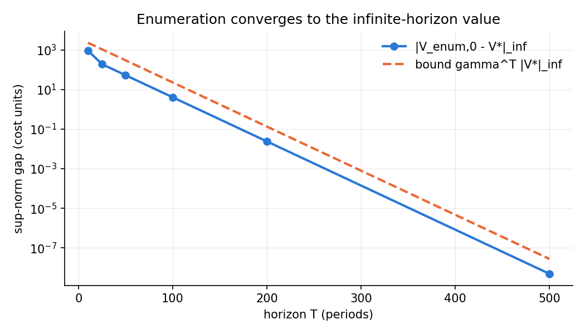
<figcaption>Figure 4. Gap between the finite-horizon value V_enum,0 and V* as a function of the horizon T, against the bound γ^T‖V*‖.</figcaption>
</figure>

#### 2.5.2 Convergence rate of VI and PI

`python -m tests.validation.mdp_convergence`

VI is a γ-contraction, so the residual should shrink by a factor 0.95 per iteration. Measured ratio
`r_{k+1}/r_k` over the last 50 iterations: mean **0.95000**, max 0.95003. On a log scale the
residual is parallel to `r_0 γ^k` (Figure 5). VI took 429 iterations (the bound
`log(tol/r_0)/log γ` predicts at most 476). PI took 6 iterations, as expected from its superlinear
(Newton-type) convergence.

<figure>
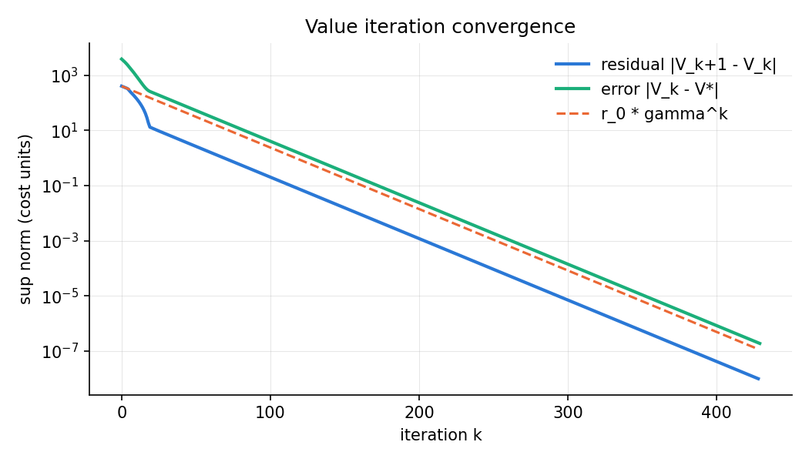
<figcaption>Figure 5. Value iteration residual ‖V_{k+1} − V_k‖_∞ on a log scale with the theoretical slope γ^k.</figcaption>
</figure>

#### 2.5.3 Hand-checkable cases

`python -m tests.validation.mdp_deterministic`

**Deterministic arrivals.** With `A ≡ 3`, s* is still 13; the reachable states are multiples of 3,
so the shuttle leaves at `s = 15` with exactly 15 people and the system cycles
`3 → 6 → 9 → 12 → 15 → (dispatch) → 3`:

```
 t  s  a    cost       V
 0  0  0   0.000 569.753
 1  3  0   6.000 599.740
 2  6  0  12.000 624.989
 3  9  0  18.000 645.252
 4 12  0  24.000 660.265
 5 15  1 100.000 669.753
 6  3  0   6.000 599.740
```

By hand: `V(3) = (6 + 12γ + 18γ² + 24γ³ + 100γ⁴) / (1 − γ⁵) = 135.673 / 0.22622 = 599.74` and
`V(0) = γ V(3) = 569.75`, matching the solver. Simulating this policy for 2000 periods gives a
discounted cost that differs from `V(0)` by 1.5·10⁻¹².

**End of horizon in enumeration.** In the last period a dispatch saves at most `2·15 = 30` of holding
cost but costs 100, so it is never worth it. The saving over the last k periods is at most
`30(1 + γ + … + γ^{k−1})`: 30, 58.5, 85.6 for k = 1, 2, 3 (all < 100) and 111.3 for k = 4. So
`π_{T−1}, π_{T−2}, π_{T−3}` should never dispatch, and dispatching should first appear at `t = T−4`.
The solver gives exactly this (thresholds from the end: none, none, none, 14, 12, 13, 13, …).

#### 2.5.4 Structural properties

`python -m tests.validation.mdp_structure`

Theory predicts `V` non-decreasing in `s` (more people never helps) and a threshold policy.
Both hold under all six settings checked: default (s* = 13), c_f = 200 (14), c_h = 5 (10),
K = 10 (9), K = 30 (17) and γ = 0.99 (13). The time-dependent enumeration policies break the
threshold shape only in the last few periods and only near `s = 200` (e.g. default: `t = T−5, s = 200`).
Close to the end of the horizon and at the cap, extra arrivals are dropped for free, so a dispatch
there saves less; this is expected and comes from assumption 2.

#### 2.5.5 Parameter sensitivity

`python -m tests.validation.mdp_sensitivity`

| sweep | s* | expectation |
|---|---|---|
| c_f = 0, 25, 50, 100, 200, 400, 800 | 1, 8, 11, 13, 14, 15, never | non-decreasing: costlier trips → larger batches ✓ |
| c_h = 0.5, 1, 2, 4, 8 | 15, 14, 13, 11, 8 | non-increasing: costlier waiting → dispatch sooner ✓ |
| K = 5, 10, 15, 20, 30, 50 | 5, 9, 13, 16, 17, 17 | rises then saturates: a big shuttle is not worth filling beyond the point where holding cost exceeds the saved trip ✓ |
| c_f = 0 | 1 | dispatch whenever anyone waits ✓ |
| c_h = 0 | never | waiting is free ✓ |

`c_f = 800` gives "never dispatch". This was checked separately: evaluating all 200 threshold
policies and "never dispatch" exactly, no threshold policy is better in any state, and
`V(200) = 8000 = c_h · 200/(1 − γ)`. The reason is assumption 2: with the cap, ignoring the queue
costs at most 400 per period, and a trip at 800 does not pay for itself.

<figure>
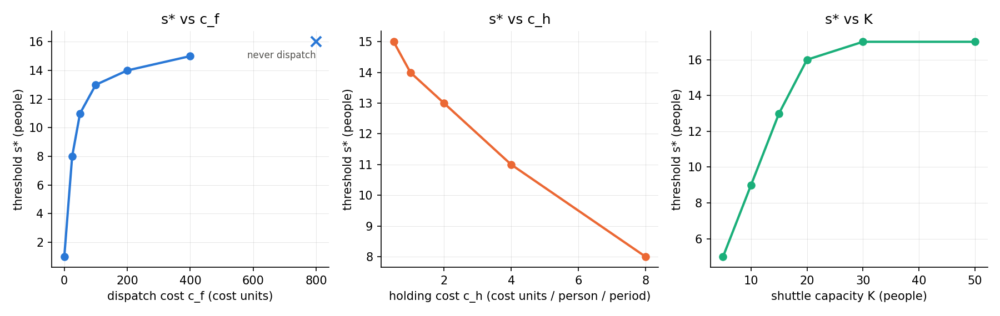
<figcaption>Figure 6. Optimal threshold s* under sweeps of c_f, c_h and K ("x" = never dispatch).</figcaption>
</figure>

### 2.6 With 3 more months (Part A)

- **Simulation check of the whole pipeline.** Run long Monte Carlo simulations of the optimal policy
  from every start state under random arrivals and compare the average discounted cost with `V*(s)`
  using confidence intervals.
- **Remove the cap.** Increase `S_MAX` (400, 800, …) and show that `V` and s* stop changing in the
  region that matters, or replace truncation with a lost-customer penalty, to confirm the cap is not
  driving the answer.
- **Prove and test the threshold structure.** Check the conditions (e.g. submodularity of `Q` in
  `(s, a)`) that guarantee a threshold policy, and build a faster solver that searches only over
  thresholds, then compare it with PI.
- **Richer models.** Time-varying (rush-hour) arrivals, Poisson or batch arrivals, several shuttles,
  limited fleet / return times, and the average-cost criterion (γ → 1).
- **Learning without the model.** Run Q-learning / SARSA on a simulator and check that they recover
  s* = 13, which tests a model-free method against a known optimum.

---

## 3. Policy Gradient, Part 1 (REINFORCE, no baseline)

All numbers below are measured from seed 0 runs plus the validation runs.

### 3.1 Algorithm

REINFORCE with one parameter update per episode:

1. Roll out one episode with the current stochastic policy `π_θ`.
2. Discounted reward-to-go within the episode: `G_t = Σ_{k≥0} γ^k r_{t+k}` (no bootstrapping; an
   episode ends at `terminated` **or** `truncated`).
3. Standardize over the episode: `A_t = (G_t − mean G) / (std G + 10⁻⁸)`.
4. Loss `L(θ) = −Σ_t log π_θ(a_t | s_t) · A_t`; one Adam step.

The objective is the discounted reward of the episode, as required. Standardizing the returns is a
common variance-reduction step and keeps the step size the same for short and long episodes. It is
the only addition to plain REINFORCE in Part 1; no baseline is used.

| | CartPole-v1 | Pong-v5 |
|---|---|---|
| γ | 0.95 | 0.99 |
| Input | 4-d state | `preprocess(frame_t) − preprocess(frame_{t−1})`, 80×80 = 6400 (zeros for the previous frame at t = 0) |
| Network | 4 → 128 (ReLU) → 2 logits, Categorical | 6400 → 200 (ReLU) → 1 logit = log-odds of RIGHT, Bernoulli |
| Actions | 0 = push left, 1 = push right | 1 → env action 2 (RIGHT), 0 → env action 3 (LEFT) |
| Returns | standard | reset to 0 whenever a point is scored (`r ≠ 0`), so each rally is credited only with its own outcome |
| Episodes | 1000 | 5000 |
| Optimizer | Adam, lr 0.01 | Adam, **lr 0.001** |
| Device | CPU | GPU (RTX 5070 Ti) |

`preprocess` is the function given in the assignment, used verbatim. Pong-v5 keeps its defaults
(frameskip 4, sticky actions with p = 0.25). The policy outputs a logit and samples from
`Bernoulli(logits=…)`, which is the same distribution as sigmoid-then-sample but keeps `log π`
finite when the probability saturates. Evaluation samples actions from the final policy (same as
training).

#### 3.1.1 Why Pong uses lr = 0.001 instead of 0.01

The assignment allows a different learning rate if training is more stable. Before the long Pong run
we trained two short runs with the same seed and tracked the mean policy entropy (maximum
ln 2 = 0.693, a coin flip). At lr = 0.01 entropy fell from 0.635 to **0.104 within ~110 episodes**
while the reward was still ≈ −20: the policy became nearly deterministic and stopped exploring
before it had learned anything. At lr = 0.001 entropy was still **0.641 after 137 episodes**. With a 6400-dimensional input and
one episode per update the gradient is large (norm 50–100), and Adam at 0.01 takes steps that are too
big. At lr = 0.001 entropy decreases slowly, leaving room to explore. CartPole keeps 0.01: it learns
well at that rate (3.2.1).

### 3.2 Results

#### 3.2.1 CartPole-v1

**Evaluation over 500 episodes: mean = 110.78, std = 4.84** (min 99, max 123).

<figure>
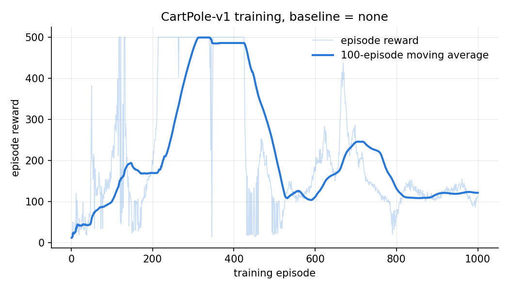
<figcaption>Figure 7. CartPole-v1, no baseline: episode reward vs. training episode, with the 100-episode moving average.</figcaption>
</figure>

<figure>
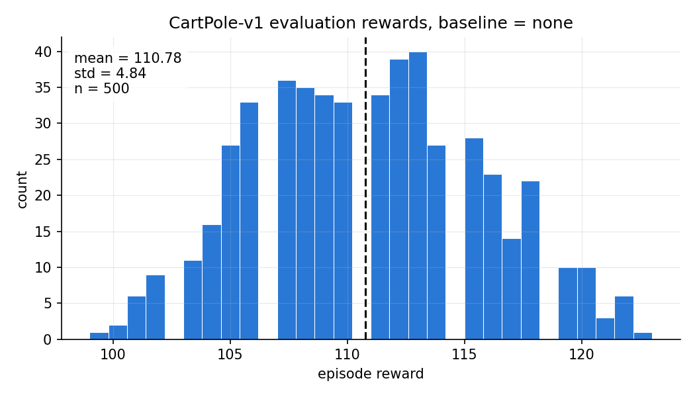
<figcaption>Figure 8. CartPole-v1, no baseline: histogram of 500 evaluation episodes of the final policy (mean 110.78, std 4.84).</figcaption>
</figure>

100-episode mean training reward:

| episodes | 0–99 | 100–199 | 200–299 | 300–399 | 400–499 | 500–599 | 600–699 | 700–799 | 800–899 | 900–999 |
|---|---|---|---|---|---|---|---|---|---|---|
| mean | 100.2 | 169.4 | 470.3 | **485.7** | 225.2 | 111.5 | 244.5 | 131.6 | 118.1 | 121.4 |
| episodes hitting 500 | 0 | 7 | 86 | 93 | 25 | 0 | 0 | 0 | 0 | 0 |

The agent learns to solve the task (93 of 100 episodes reach the 500-step cap around episode 300),
then performance collapses and settles near 120. The evaluation uses the final policy, as the
assignment asks ("when you finish training"), so it reports the collapsed policy, not the peak.
The 5-seed experiment (3.4.5) shows this is a property of the algorithm with these settings, not a
bad seed: every seed reaches or approaches 500 at some point, and none stays there. We traced the
collapse of seed 0 to two causes:

1. **Truncation looks like failure after standardization.** CartPole-v1 stops at 500 steps even when
   the pole is perfectly balanced. With γ = 0.95, a 500-step episode has `G_0 ≈ 20` but
   `G_499 = 1`, only because the episode was cut off. After per-episode standardization the last
   **63 steps (t = 437…499) get negative advantage, down to A = −7.0 at t = 499**, so a perfect
   episode actively pushes down the probability of correct actions. Once the policy is good, every
   episode is like this, which destabilizes it.
2. **Short effective horizon.** γ = 0.95 means an effective horizon of `1/(1 − γ) = 20` steps. In 49
   of 50 evaluation episodes, the episode ends because the **cart leaves the track (|x| > 2.4)**, not
   because the pole falls. The final policy balances the pole well (P(right) follows the pole's
   angular velocity, 3.4.3) but drifts slowly to one side; the cost of that drift arrives ~100 steps
   later and is almost invisible to a 20-step discount. This also explains the very small evaluation
   std: the drift makes episodes end at almost the same time.

A state-value baseline (Part 2) cannot remove the first cause: the time step is not part of the
CartPole state, so `V(s)` cannot tell step 100 from step 490 of a balanced episode (4.2.1).

#### 3.2.2 Pong-v5

**Evaluation over 500 episodes: mean = 13.20, std = 4.37** (min −12, median 14, max 21). The agent
won 98.4% of the games (1 shutout), with a mean length of 3936 steps. This matches the last 100
training episodes (+13.94), so the final policy did not overfit to training episodes. The left tail
(8 games lost, worst −12) comes from sampled actions plus sticky actions occasionally producing a
run of missed balls.

<figure>
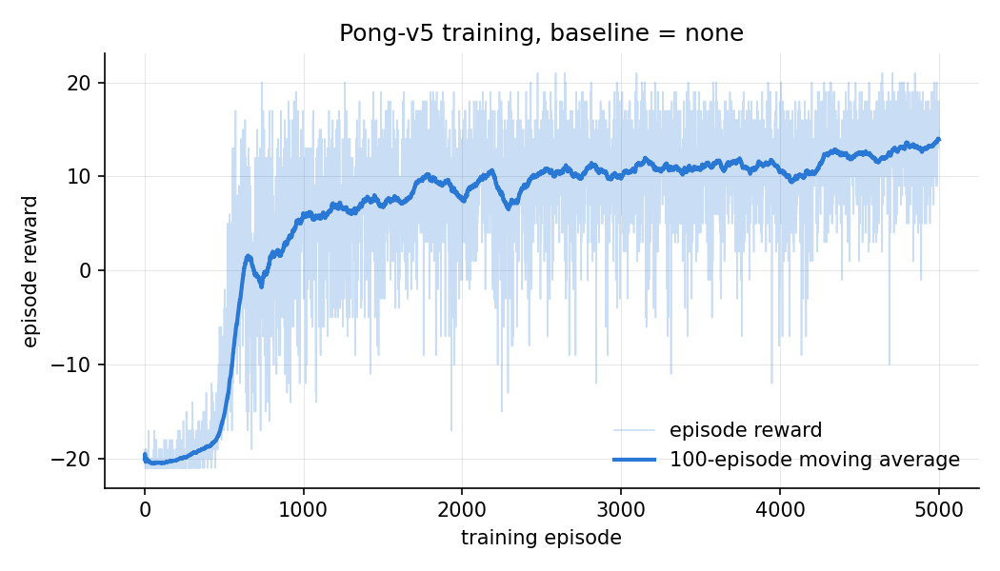
<figcaption>Figure 9. Pong-v5, no baseline: episode reward vs. training episode, with the 100-episode moving average.</figcaption>
</figure>

<figure>
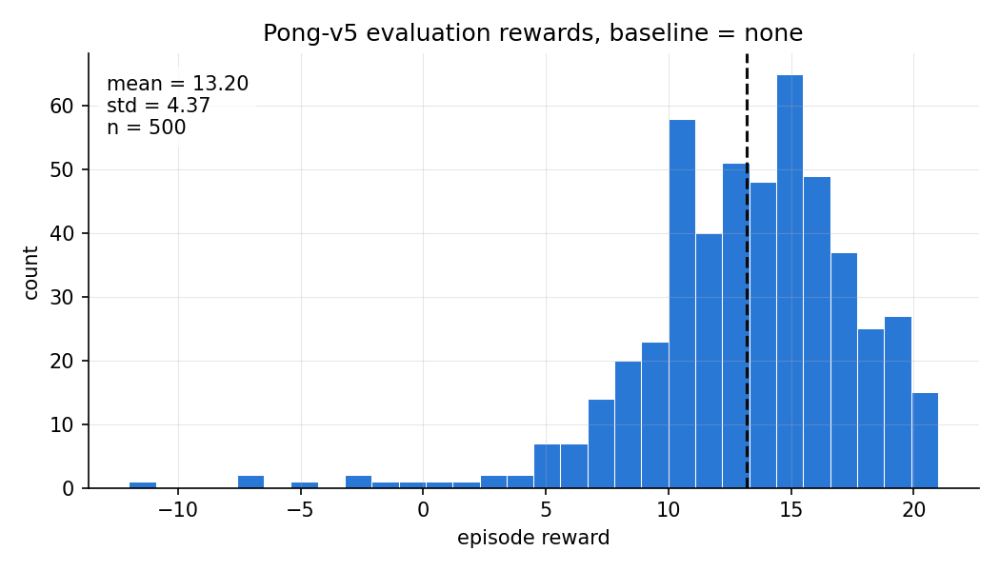
<figcaption>Figure 10. Pong-v5, no baseline: histogram of 500 evaluation episodes of the final policy (mean 13.20, std 4.37).</figcaption>
</figure>

Trained with lr = 0.001 (3.1.1) for 5000 episodes (interrupted once and continued with `--resume`;
the log has 5000 consecutive episodes).

- For ~500 episodes the agent loses almost every point (the reward signal is sparse and the policy
  starts near random). The 100-episode moving average then rises quickly: it passes −15 at episode
  505, **0 at episode 623**, and 10 at episode 1768.
- After that it keeps improving slowly. **Final 100-episode mean: +13.94**; the agent won every one
  of the last 500 training games and had 7 shutouts (21–0) during training.
- Mean reward per 500 episodes rises from −18.85 (episodes 0–499) to 12.92 (4500–4999).
- Episodes get ~4× longer (1072 → ~4000 steps) once the agent returns the ball, as expected.
- Mean entropy per 500 episodes decreases gradually (0.54 → 0.07) and tracks the improvement in reward, unlike the
  lr = 0.01 run where it collapsed to 0.10 within ~110 episodes at reward −20 (3.1.1).
- The per-episode reward stays noisy (light curve, roughly −5 to +21 late in training) because the
  policy samples actions and v5 has sticky actions (p = 0.25).

### 3.3 Edge cases and how they are handled

| Edge case | Handling | How it is checked |
|---|---|---|
| Episode ends by truncation (CartPole 500-step cap) | `terminated or truncated` ends the episode; returns are computed inside the episode only, no bootstrap | 3.2.1 analyses the effect of truncation on standardized advantages |
| Standardizing a constant return vector (e.g. a 1-step episode) | `std + 10⁻⁸`; constant input maps to zeros, no NaN | unit test |
| Pong rewards are sparse and per point | returns reset at every nonzero reward, so a point lost later does not blame actions from an earlier rally that was won | unit test (hand-computed example); 3.4.3: `G_0 = −0.99^63` for a point lost at step 63 |
| No previous frame at the start of a Pong episode | the previous frame is all zeros | unit test; 3.4.3 (t = 0 input is the frame itself) |
| `preprocess` modifies its input in place (slice assignment) | called on a copy so the environment's observation is untouched | unit test |
| Only RIGHT/LEFT allowed in Pong | policy is binary; mapping 1→2, 0→3 | unit test |
| Saturated sigmoid gives `log 0` | network outputs logits; `Bernoulli(logits=…)` computes log-prob stably | no NaN in training logs |
| Long Pong episodes and GPU memory | only the current episode is stored; backward is done per episode | Pong runs with constant memory |
| Long Pong runs can be interrupted | checkpoint every 100 episodes (policy, optimizer, RNG states); `--resume` continues the episode count | an interrupted run continues at the next episode and log rows after the checkpoint are dropped; the Pong run was interrupted and resumed in practice with a continuous log |
| Reproducibility | one seed fixes python, numpy, torch (CPU and CUDA) and the environment | CartPole seed 0 retrained: all 1000 episode rewards identical |
| Policy collapses to one action (π → 1) | not prevented (plain REINFORCE has no entropy bonus); detected through the logged entropy and gradient norm | 2 of 5 CartPole seeds collapse to ~9 steps (3.4.5); Pong lr chosen to avoid early collapse (3.1.1) |

### 3.4 Validation tests

#### 3.4.1 Random policy reference

`python -m tests.validation.pg_random_baseline`

| game | episodes | mean | std | min | max |
|---|---|---|---|---|---|
| CartPole | 100 | 23.16 | 11.90 | 8 | 63 |
| Pong (RIGHT/LEFT only) | 20 | −20.55 | 0.74 | −21 | −19 |

A learning curve only means something relative to chance. Trained CartPole is ~5× above random at
the end and ~21× at its peak; trained Pong is +13 against −20.6.

#### 3.4.2 Sign flip

`python -m tests.validation.pg_sign_flip`

Same seed and settings, but trained on `−G_t`. If the gradient is correct, the flipped agent should
learn the *opposite* task (drop the pole as fast as possible) and do worse than random.

| run | last-100 mean reward |
|---|---|
| normal | 121.37 |
| random policy | 22.87 |
| **flipped** | **9.27** |

The flipped agent reaches ~9, the shortest episode CartPole allows. The two runs leave the random
level in opposite directions (Figure 11), which shows that the update moves probability toward
high-return actions. A sign error in the loss, log-prob or returns would not produce this picture.

<figure>
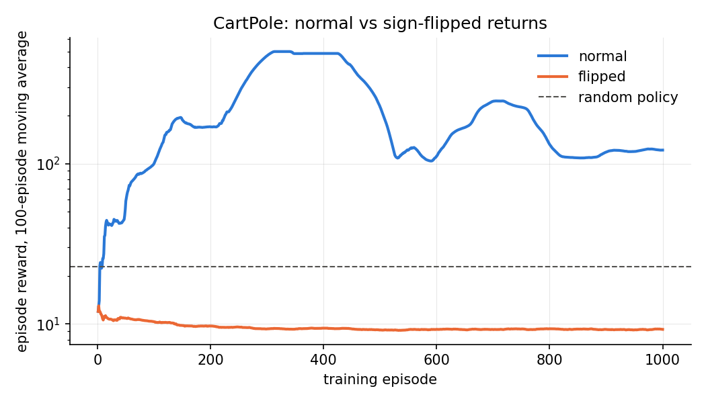
<figcaption>Figure 11. CartPole trained on G_t (normal) and on −G_t (flipped), 100-episode moving averages (log scale), with the random-policy level.</figcaption>
</figure>

#### 3.4.3 First 10 steps by hand

```
python -m tests.validation.pg_first_steps --env cartpole
python -m tests.validation.pg_first_steps --env cartpole --run cartpole_none_s0
python -m tests.validation.pg_first_steps --env pong
```

- **CartPole, untrained**: episode of length L = 12. Every reward is 1, so
  `G_t = (1 − 0.95^{L−t}) / 0.05`; max deviation from this closed form is 1.8·10⁻¹⁵. `P(a=1)` is
  0.37–0.48 (close to 0.5). Advantages are positive for early steps and negative for the last ones
  (A changes sign at t = 6), i.e. the steps right before the pole falls are blamed.
- **CartPole, trained**: `P(push right)` follows the pole's angular velocity `s3`: when `s3 ≈ 0.6–0.66`
  (pole falling right) `P = 0.88–0.99`; when `s3 ≈ 0.02–0.35`, `P = 0.00–0.19`. The policy has learned
  a physically sensible control rule.
- **Pong, untrained**: `P(RIGHT) ≈ 0.48–0.49`. First point lost at step 63 (`r = −1`), so every step of
  that rally has `G_t = −0.99^{63−t}`: `G_0 = −0.5309` ✓. The frame difference at t = 2 has 0 nonzero
  pixels — nothing moved between those frames, as expected.

#### 3.4.4 Preprocessing check

`python -m tests.validation.pg_preprocess_viz`

The raw crop contains red-channel values {92, 144, 213, 236}; after preprocessing the background
values 144/109 are gone, the frame is binary {0, 1} with 32 of 6400 pixels on, located in columns
8–9 (opponent paddle) and 70–71 (our paddle) plus the ball. The score is cropped away. In the
difference image only moving objects remain as +1/−1 pairs (10 / 12 pixels), which is what lets an
MLP infer the direction of motion from a single input (Figure 12).

<figure>
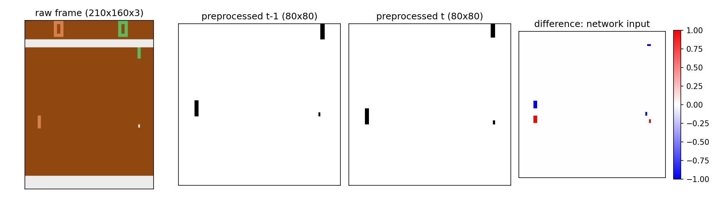
<figcaption>Figure 12. Raw Pong frame, two consecutive preprocessed frames, and their difference (the network input).</figcaption>
</figure>

#### 3.4.5 Five seeds

`python -m tests.validation.pg_multi_seed --env cartpole --baseline none --seeds 0 1 2 3 4`

One seed proves nothing for a high-variance method, so CartPole was trained with 5 seeds and the
same settings. Final 100-episode mean per seed: 121.37, 89.63, 480.59, 9.59, 9.33
(**142.10 ± 174.90**); final 100-episode policy entropy: 0.32, 0.21, 0.30, 0.06, 0.001.
In Figure 13 the ±1 std band dips below 0 only because the 5 values are far from symmetric; no
episode scores below 8.

<figure>
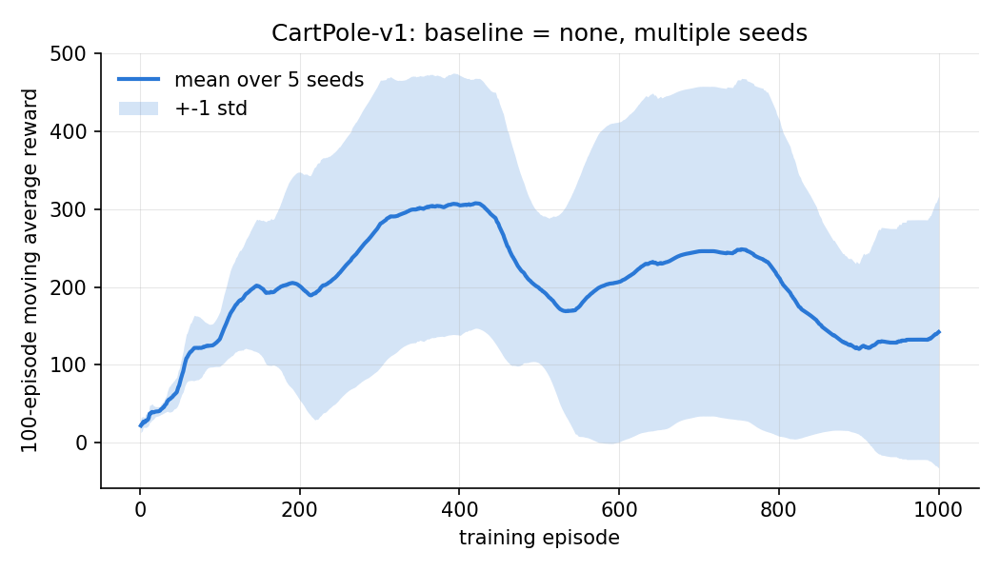
<figcaption>Figure 13. CartPole, no baseline, 5 seeds: mean ± 1 std of the 100-episode moving average.</figcaption>
</figure>

- **The algorithm learns**: every seed rises well above random (23) early on, and seeds 0–3 reach
  ~450–500 at some point.
- **It is unstable**: seeds 0–2 keep oscillating between ~100 and 500.
- **2 of 5 seeds collapse to a deterministic single-action policy** (entropy ≈ 0, ~9 steps per
  episode — the same level as the sign-flipped agent, below random). The episodes around the
  collapse:

  | seed | trigger | after |
  |---|---|---|
  | 4 | episode 86: 90-step episode, grad norm 30.6 (median over run ≈ 6) | entropy 0.55 → 0.27 → 0.16 → 0.05 within 5 episodes, grad norm falls to 0.06–0.3 |
  | 3 | episode 480: grad norm 28.1 | entropy 0.56 → 0.03; grad norm falls to 0.1–0.6 |

  Mechanism: (1) the loss is a sum over steps, so a long episode with lr = 0.01 can produce one
  large step that pushes the logits far toward one action; (2) per-episode standardization removes
  the information that a 9-step episode is much worse than a 200-step one — even a 9-step failure
  has positive advantages on its first half, so it keeps reinforcing the dominant action; (3) once
  π(a|s) ≈ 1, `∇ log π = (1 − π) ∇ logit ≈ 0`, so the policy cannot leave this state. This is a
  property of plain REINFORCE with these settings, not a code bug: with the same code, the
  sign-flip test (3.4.2) and seeds 0–2 behave as theory predicts.

### 3.5 With 3 more months (Part 1)

- Handle truncation correctly (bootstrap or add the time step to the state) and measure how much of
  the CartPole collapse disappears.
- Learning-rate and γ sweeps over many seeds (e.g. lr ∈ {10⁻⁴ … 10⁻²}, γ ∈ {0.95, 0.99}) with
  confidence intervals, plus early stopping / keeping the best checkpoint.
- Batch several episodes per update and add an entropy bonus; compare variance and sample efficiency.
- For Pong: CNN policy, more seeds and longer training, and evaluation without sticky actions to
  separate policy quality from environment noise.

---

## 4. Policy Gradient, Part 2 (REINFORCE with a value baseline)

### 4.1 Chosen baseline and implementation

We use a **state-dependent (non-constant) baseline `b_t = V_φ(s_t)`**, a learned value network.

Why this baseline:

- The variance-optimal constant baseline is roughly the mean return, but returns in both games
  depend strongly on the state (in CartPole on how close the pole/cart is to failing; in Pong on
  where the ball is). A state-value function removes that state-dependent part as well, so it should
  reduce variance more than a constant (4.4.2 confirms: 99× vs 9× lower gradient variance).
- It keeps the gradient unbiased: `b_t` depends only on `s_t`, not on `a_t`, so
  `E[∇ log π(a_t|s_t) · b(s_t)] = 0`.
- It works together with the per-episode standardization used in Part 1, so all Part 1 settings can
  stay the same and the Part 1 runs serve as the no-baseline comparison. (A constant baseline would
  be cancelled exactly by standardization, which subtracts the mean anyway.)

Implementation (`pg/baselines.py`, class `ValueBaseline`; update in `pg/reinforce.py`):

| Item | Choice |
|---|---|
| Value network | CartPole: 4 → 128 (ReLU) → 1. Pong: 6400 → 200 (ReLU) → 1, same frame-difference input as the policy |
| Target | raw discounted return `G_t` (same `G_t` as the policy, including the Pong reset at each point) |
| Loss | `MSE(V_φ(s_t), G_t)` over the episode, one Adam step per episode |
| Optimizer | separate Adam, lr equal to the policy lr (CartPole 0.01, Pong 0.001) |
| Advantage | `A_t = standardize(G_t − V_φ(s_t).detach())`: the baseline is subtracted **before** standardization |
| Order per episode | compute `b_t` with the current `V_φ` → policy step → value step, so `b_t` never uses the current episode's targets |

`detach()` is essential: without it the policy loss would also push gradients into `φ`. A unit test
checks that the policy loss gives no gradient to `φ`.

All other settings are identical to Part 1 (seed 0, γ, learning rates, episodes, standardization),
so differences come from the baseline alone.

### 4.2 Results

#### 4.2.1 CartPole-v1

**Evaluation over 500 episodes: mean = 124.46, std = 5.53** (Part 1 without baseline:
110.78 ± 4.84).

<figure>
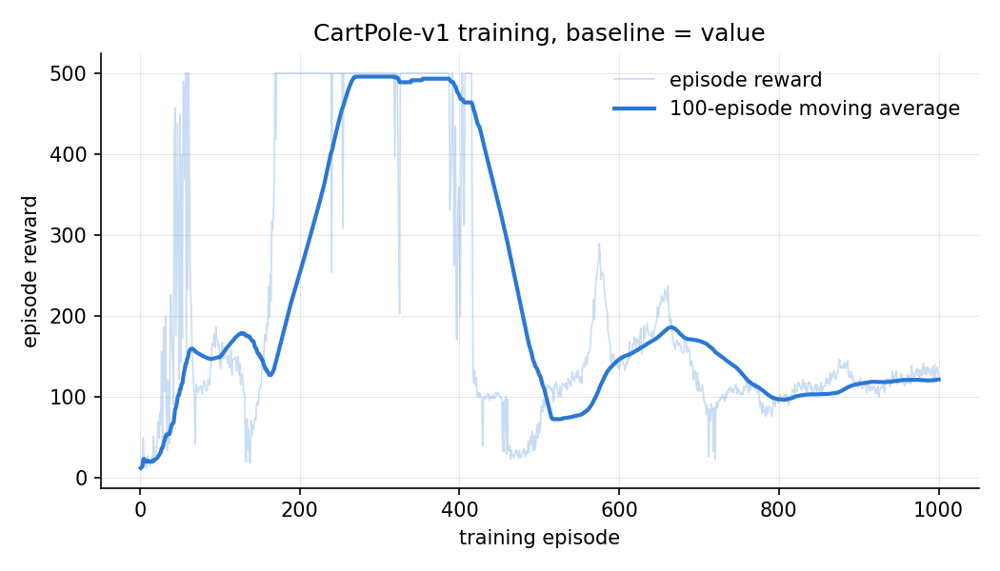
<figcaption>Figure 14. CartPole-v1, value baseline: episode reward vs. training episode, with the 100-episode moving average.</figcaption>
</figure>

<figure>
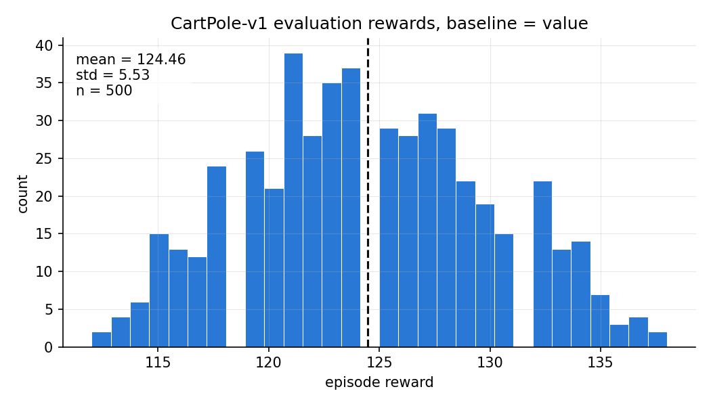
<figcaption>Figure 15. CartPole-v1, value baseline: histogram of 500 evaluation episodes of the final policy (mean 124.46, std 5.53).</figcaption>
</figure>

<figure>
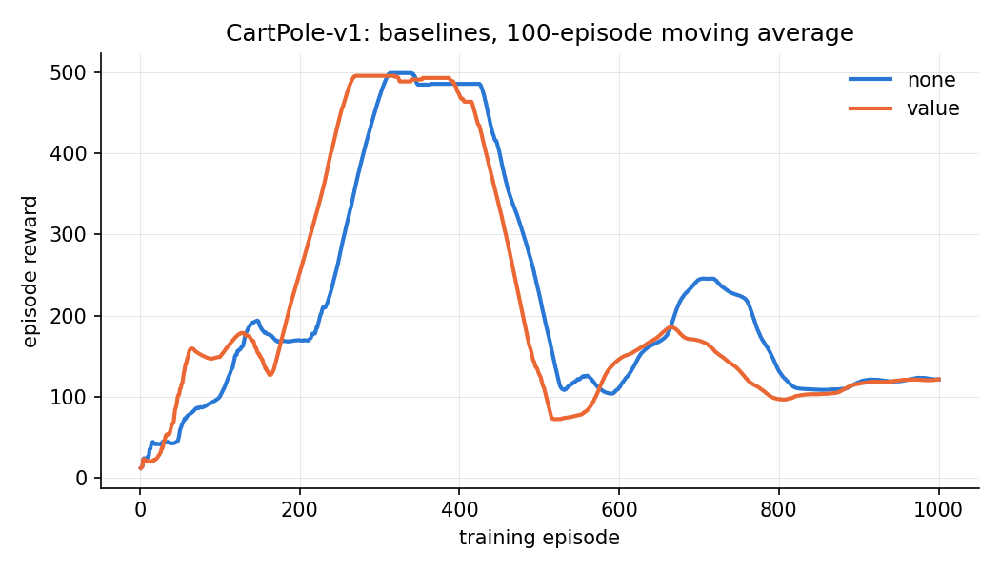
<figcaption>Figure 16. CartPole-v1: 100-episode moving average with no baseline (Part 1) and with the value baseline.</figcaption>
</figure>

<figure>
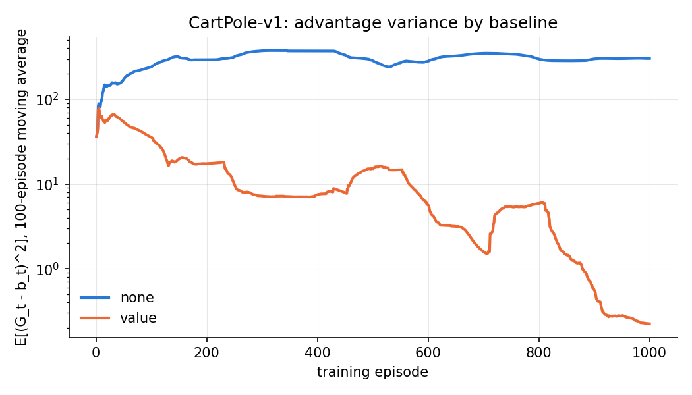
<figcaption>Figure 17. CartPole-v1: mean squared advantage E[(G_t − b_t)²] per episode (before standardization), log scale.</figcaption>
</figure>

- **Faster early learning**: the value baseline is ahead for the first 300 episodes (100-episode
  means 149 / 253 / 496 vs 100 / 169 / 470) and reaches the 500-step cap about 30 episodes earlier;
  227 vs 211 episodes reach 500 in total.
- **Much lower advantage variance**: `E[(G_t − b_t)²]` stays around 300 without a baseline and falls
  from ~50 to **0.22** with the value baseline (3 orders of magnitude, Figure 17).
  The value loss falls from 35.5 (first 100 episodes) to 0.22 (last 100).
- **But it collapses after episode ~400 like Part 1**, and the final policy is only slightly better.

Why the baseline does not prevent the collapse (checked on one evaluation episode of the final
policy):

1. **Terminated episodes are predicted almost perfectly**: corr(V, G) = 1.00 within the episode; the
   state just before failure (cart near the edge) tells V that the episode is about to end.
2. **Truncated episodes cannot be predicted**: the 500-step cap is a function of time, and time is
   not in the CartPole state. V for a balanced state is ≈ 20 (e.g. V(s_0) = 20.00), while the true
   `G_t` in the last steps of a truncated episode goes down to 1. So the last ~60 steps of a perfect
   episode still get large negative advantages — cause 1 of 3.2.1 remains.
3. **Standardization amplifies noise**: once V is accurate, `G_t − V(s_t)` is only noise (≈ ±0.1).
   Per-episode standardization rescales it to std 1, so every update still has full size even when
   there is little signal. In the checked episode the last step has `G − V = −2.1`, which becomes
   `A = −5.93` after standardization.

#### 4.2.2 Pong-v5

5000 episodes, seed 0, lr 0.001 for both networks, all other settings as in Part 1.

**Evaluation over 500 episodes: mean = 12.57, std = 4.36** (Part 1 without baseline: 13.20 ± 4.37).

<figure>
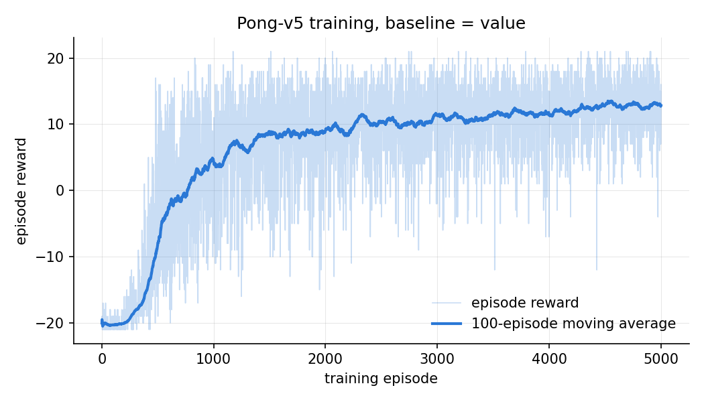
<figcaption>Figure 18. Pong-v5, value baseline: episode reward vs. training episode, with the 100-episode moving average.</figcaption>
</figure>

<figure>
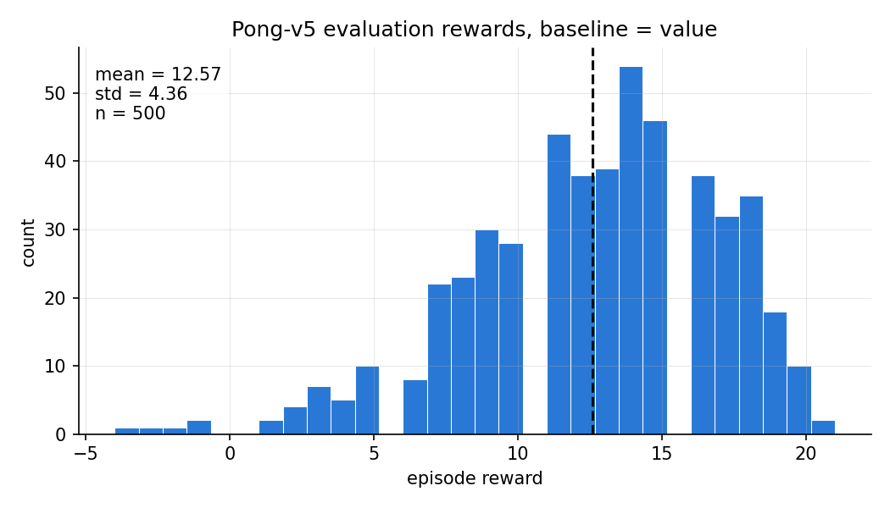
<figcaption>Figure 19. Pong-v5, value baseline: histogram of 500 evaluation episodes of the final policy (mean 12.57, std 4.36).</figcaption>
</figure>

| evaluation, 500 episodes | none (Part 1) | value |
|---|---|---|
| mean ± std | **13.20** ± 4.37 | 12.57 ± 4.36 |
| median | 14 | 13 |
| games won | 98.4% | **99.0%** |
| worst game | −12 | **−4** |

The value policy scores 0.63 points less on average (Welch t-test p = 0.02) but loses fewer games
and has no very bad game. With one training seed per method this compares two trained policies, not
the two methods in general.

<figure>
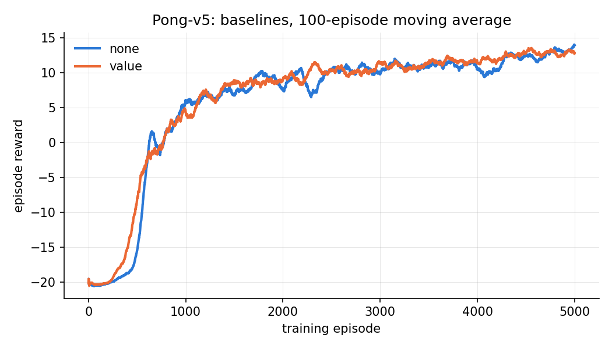
<figcaption>Figure 20. Pong-v5: 100-episode moving average with no baseline (Part 1) and with the value baseline.</figcaption>
</figure>

<figure>
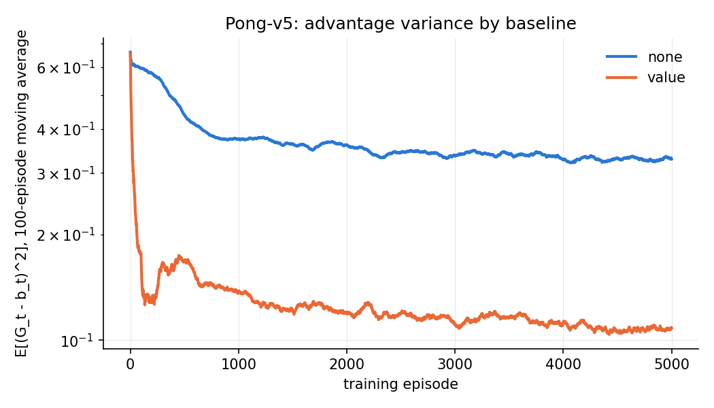
<figcaption>Figure 21. Pong-v5: mean squared advantage E[(G_t − b_t)²] per episode (before standardization), log scale.</figcaption>
</figure>

| training | none (Part 1) | value |
|---|---|---|
| 100-ep moving average first ≥ −10 | episode 551 | **479** |
| 100-ep moving average first ≥ 0 | **623** | 765 |
| 100-ep moving average first ≥ +10 | **1768** | 2086 |
| final 100-episode mean | 13.94 | 12.83 |
| best 100-episode moving average | 14.02 | 13.53 |
| episodes won, last 100 | 100% | 99% |
| `E[(G_t − b_t)²]`, episodes 4000–4999 | 0.328 | **0.108** |

- **Advantage variance is about 3× lower** for the whole run (0.15 vs 0.46 in the first 1000
  episodes, 0.108 vs 0.328 in the last 1000). The value loss (MSE on raw returns in [−1, 1]) falls
  from 0.152 to 0.108.
- **Earlier start**: the value run leaves the −21 floor sooner (moving average −10 at episode 479 vs
  551; first 500 episodes −16.3 vs −18.8).
- **Smoother curve**: the no-baseline run has a sharp jump around episode 620 and two drops (around
  episodes 2300 and 4100, moving average down to ~7 and ~10). The value run has neither.
- **Same final level**: after ~1000 episodes the two curves are within about 1 point of each other.
  The value run crossed 0 and +10 later, because the no-baseline run's quick jump at ~620 reached 0
  earlier. Both end near +13 with almost every game won.
- V removes part of the variance (3× less), not almost all of it as in CartPole (1000× less).
  Likely reasons (not tested separately): Pong returns already reset after every point, so `G_t` is
  a short signal in [−1, 1] with no large constant offset to remove; and much of a point's outcome
  depends on later actions and sticky-action noise, which `V(s_t)` cannot predict.

### 4.3 Edge cases and how they are handled

| Edge case | Handling | How it is checked |
|---|---|---|
| Policy gradient leaking into the value network | `V_φ(s).detach()` in the advantage | unit test: policy loss gives no gradient to φ |
| Baseline using the current episode's targets (bias) | `b_t` computed before the value update | fixed order in the update function |
| Scale mismatch between V and standardized returns | V fits raw `G_t`; standardization applied after subtracting | value loss decreases to 0.22 (CartPole) |
| Untrained V at the start (random predictions) | advantage is standardized, so a bad early V cannot blow up the step size | explained variance starts at −0.49 and training still proceeds (4.4.1) |
| Constant baseline cancelled by standardization | reason for choosing a state-dependent baseline | unit test: mean baseline + standardization gives the same update as no baseline |
| Pong value target with the per-point reset | V fits the same reset returns as the policy | same return function as the policy |
| Resume of a long Pong run | value network weights and its Adam state are saved in the checkpoint | resumed run continues at the next episode with the value network and value lr 0.001 restored |
| Truncation (time not in the state) | not fixable by a state-value baseline; documented | 4.2.1 analysis |

### 4.4 Validation tests

#### 4.4.1 Does the value network learn?

`python -m tests.validation.pg_value_fit --env cartpole`

Before each value update, the correlation between `V_φ(s_t)` and `G_t` and the explained variance
`1 − Var(G − V) / Var(G)` are recorded:

| | first 50 episodes | last 50 episodes |
|---|---|---|
| corr(V, G) | −0.414 | **0.997** |
| explained variance | −0.485 | **0.992** |

Explained variance > 0 is exactly the condition under which the baseline reduces variance
(`Var(G − V) < Var(G)`). It starts negative (random network) and ends at 0.99 (Figure 22).
The rise is not monotone: between episodes ~200 and ~400, when most episodes reach the 500-step
cap, the fit drops back to about 0. This is the truncation effect of 4.2.1 seen from the value
network's side: returns of truncated episodes depend on time, which V cannot see.

<figure>
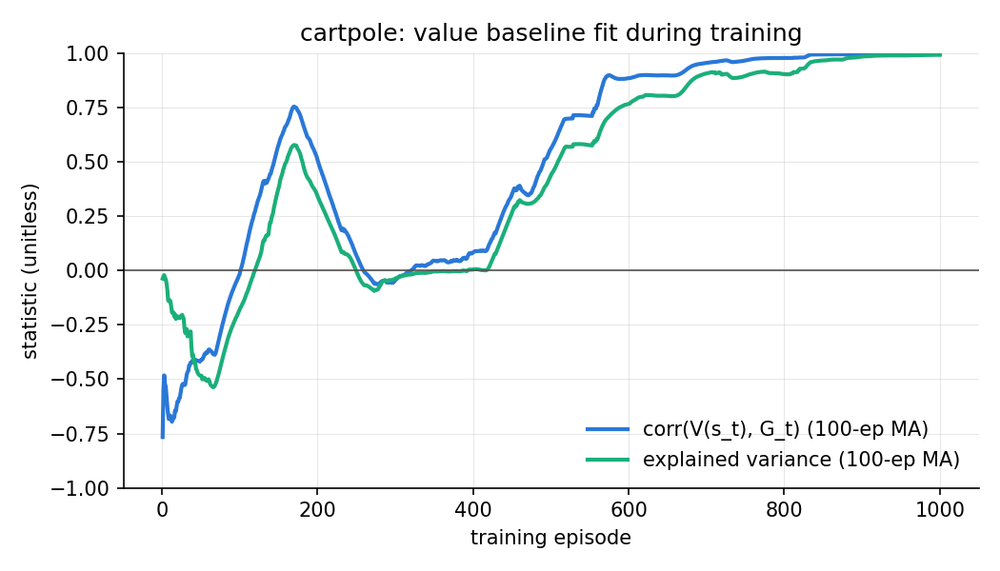
<figcaption>Figure 22. CartPole, value baseline: correlation between V(s_t) and G_t and explained variance during training.</figcaption>
</figure>

#### 4.4.2 Does the baseline reduce gradient variance?

`python -m tests.validation.pg_baseline_variance --env cartpole`

Fix a policy (100 warm-up REINFORCE episodes), fit each baseline on 100
episodes, then compute per-episode policy gradients on the *same* 100 fresh episodes with each
baseline (no standardization, so only `b` differs). The expected gradient is the same for all three;
only the spread should differ.

| baseline | tr Cov(g) | Var(‖g‖) | E[(G − b)²] |
|---|---|---|---|
| none | 4.95 × 10⁵ | 1.19 × 10⁵ | 346.2 |
| mean (constant) | 5.47 × 10⁴ (9× lower) | 1.52 × 10⁴ | 14.17 |
| **value** | **4995 (99× lower)** | **1904** | **1.058** |

This is the ordering theory predicts, value < mean < none: subtracting `E[G]` removes the large
constant part of CartPole's all-positive returns, and `V(s)` also removes the state-dependent part.
The same ordering holds during training (500 episodes per baseline, standardization off): mean
`E[(G − b)²]` is 216.7 / 16.93 / 15.71 for none / mean / value.

#### 4.4.3 Five seeds with the value baseline

`python -m tests.validation.pg_multi_seed --env cartpole --baseline value --seeds 0 1 2 3 4`

Same settings as 3.4.5 (1000 episodes, standardization on), seeds 0–4.

| seed | 0 | 1 | 2 | 3 | 4 | across seeds |
|---|---|---|---|---|---|---|
| none: final-100 mean (Part 1) | 121.37 | 89.63 | 480.59 | 9.59 | 9.33 | 142.10 ± 174.90 |
| **value: final-100 mean** | 121.45 | 466.06 | 168.35 | 136.59 | 127.53 | **204.00 ± 132.02** |
| none: mean over all 1000 episodes | 217.8 | 299.6 | 322.6 | 165.5 | 16.9 | 204.5 ± 122.3 |
| value: mean over all 1000 episodes | 214.6 | 247.4 | 185.0 | 105.8 | 209.7 | 192.5 ± 53.3 |
| none: final-100 policy entropy | 0.316 | 0.206 | 0.297 | 0.060 | 0.001 | |
| value: final-100 policy entropy | 0.294 | 0.427 | 0.176 | 0.251 | 0.171 | |

<figure>
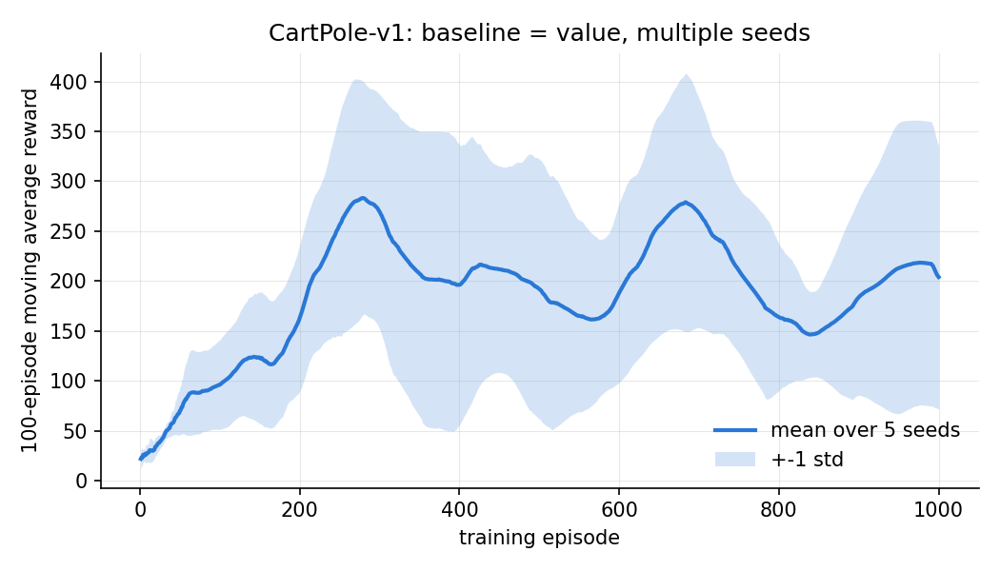
<figcaption>Figure 23. CartPole, value baseline, 5 seeds: mean ± 1 std of the 100-episode moving average (compare Figure 13).</figcaption>
</figure>

- **No seed collapsed with the value baseline.** Without a baseline, 2 of 5 seeds ended in a
  near-deterministic policy (entropy 0.06 and 0.001, ~9 steps per episode). With the value baseline
  every seed keeps entropy ≥ 0.17 and its final-100 mean ≥ 121.
- **More consistent across seeds**: the spread of the whole-run mean drops from ±122 to ±53.
- **Not a higher peak**: the whole-run mean is about the same (192.5 vs 204.5), and the value runs
  reach 500 steps less often (711 vs 1378 episodes over the 5 seeds). The truncation problem of
  4.2.1 limits both.
- **Caveats.** We did not find the mechanism. The largest gradient norms are similar with and without
  the baseline (130–275 in both), so "smaller updates" does not explain it. With 5 seeds, 0/5 vs 2/5
  collapses is not statistically significant (Fisher exact test p ≈ 0.44). The result is consistent
  with lower-variance updates making collapse less likely, but more seeds would be needed to claim it.

### 4.5 With 3 more months (Part 2)

- Add the time step (or time remaining) to the value network's input, or bootstrap at truncation,
  and test whether the CartPole collapse disappears.
- Compare standardized vs. raw advantages with each baseline over many seeds; batch several
  episodes per update so standardization is over a batch rather than one episode.
- Actor-critic / GAE(λ): use the value network for bootstrapped advantages and study the
  bias–variance trade-off as λ varies.
- Run the Pong comparison with several seeds per baseline, so that the difference in evaluation
  scores can be attributed to the method rather than to one training run.
- Share a convolutional trunk between the policy and value network in Pong.
